 

### 👋 你好，我是 shihonghu

后端工程师，在合肥。关注 **AWS 云原生、AI 集成、高并发系统和后端性能优化**。

Backend engineer based in Hefei. I work on AWS cloud-native systems, AI integration, high-concurrency services and backend performance.

 

### 🐳 现在在做

**[大肥鱼 · DeepSeek Daughter](https://github.com/shilaoban666/deepseek-daughter)**：一个有身体、大脑、记忆和性格的开源 AI 伙伴。她会饿会困，有 14 个脑区和六层记忆，你不找她，她也在过自己的一天。Windows 桌面程序，数据只在本机。

 

### 🧰 项目

| 项目 | 做什么 | 技术 |
| :-- | :-- | :-- |
| 🐳 **[deepseek-daughter](https://github.com/shilaoban666/deepseek-daughter)** | 有身体、大脑、记忆的 AI 伙伴，Windows 桌面程序 | JavaScript · Electron · three.js |
| 🏯 **[dsh-imperial-court](https://github.com/shilaoban666/dsh-imperial-court)** | 三省六部：DSH 多工具协作插件，一家拟旨、另一家封驳，复核过了再合并 | JavaScript |
| 🤖 **[Honghu-ai-assigment](https://github.com/shilaoban666/Honghu-ai-assigment)** | AI 助手，研究 AI 和智能体里还没解决的问题（后端） | Java |
| 🖥️ **[Honghu-ai-assigment-UI](https://github.com/shilaoban666/Honghu-ai-assigment-UI)** | 上面那个助手的网页界面 | Vue |
| 🐍 **[Honghu-ai-assigmemt-python](https://github.com/shilaoban666/Honghu-ai-assigmemt-python)** | 同一个助手的 Python 部分 | Python |
| 🚪 **[Honghu-ai-infra-gateway](https://github.com/shilaoban666/Honghu-ai-infra-gateway)** | 大模型推理网关：智能路由、成本与性能可观测、GPU 平台治理 | Go |
| 📏 **[honghu-ai-rag-eval](https://github.com/shilaoban666/honghu-ai-rag-eval)** | RAG 评估 | Python |
| ✍️ **[Tsuykiyo-blog](https://github.com/shilaoban666/Tsuykiyo-blog)** | 博客 | TypeScript |

 

### 🛠️ 常用技术

 

🐳 最近的时间都花在大肥鱼上。欢迎来 <a href="https://github.com/shilaoban666/deepseek-daughter/issues">提问题</a>，或者点一个 ⭐。

